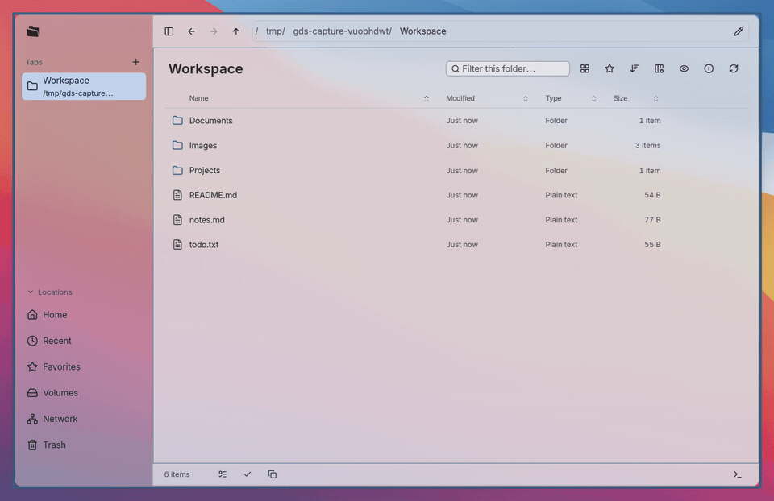

English | [简体中文](docs/i18n/zh-CN/README.md)

# GDS (Gan Desktop Suit)

GDS is a project to build a modern Wayland desktop that looks good and is easy for anyone to use.

We're building the apps you use every day on Linux around one shared design language, so you don't need a technical background to feel at home on Linux.

We care about how software looks and feels, especially personalization and themes that follow your system.

Early on, we're focusing on Niri + NixOS + DMS, filling in the desktop apps that DMS is missing or that still need some work.

## Desktop apps

### Files

GDS Files is a native file manager for everyday browsing and organizing, with a familiar interface, an integrated terminal, and full keyboard controls.

[Details and installation →](bin/files/README.md)
