English | [简体中文](docs/i18n/zh-CN/README.md)

> This project is still in early development. Features and the interface will keep changing.
> **Linux + Wayland** is the primary support target. Support for X11, Windows, and macOS is still a work in progress.

# 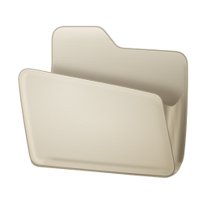 GDS Files

GDS Files is a native file manager built with GPUI, focused on making file browsing on Wayland beautiful and easy.

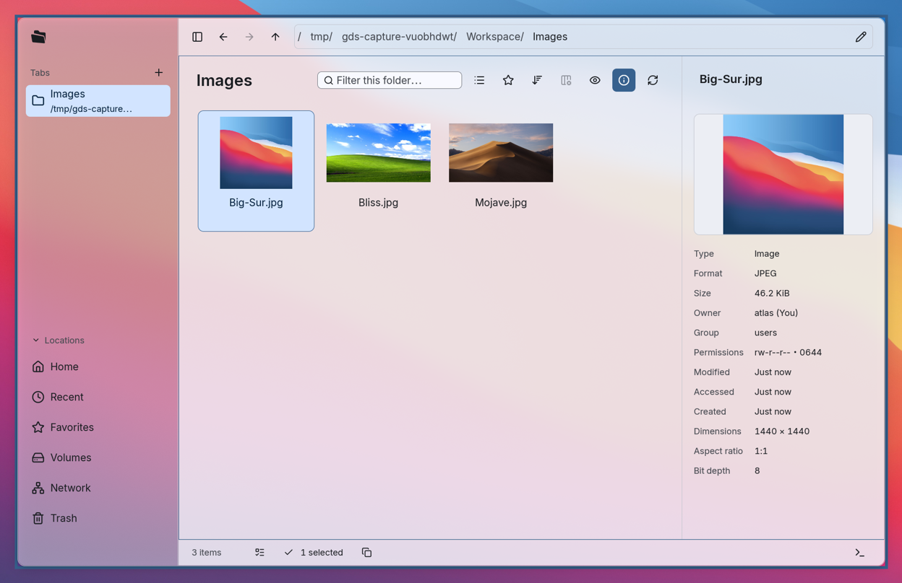

## Key features

### Even a gorilla can use it!

A full file browser with a familiar Windows File Explorer feel. You don't need to be a tech person to get started.

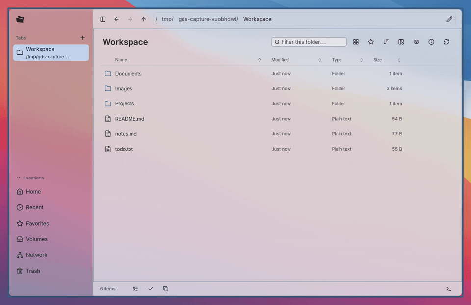

### Whoa! A terminal, right here!

On Linux, the terminal might be even more essential than the file manager. So we've included a simple one to make life easier for power users.

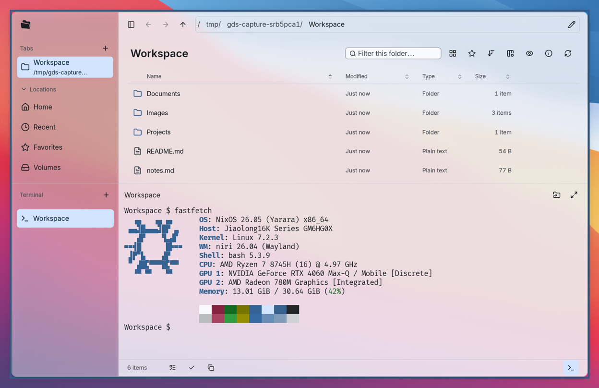

### Translucent windows that follow my system theme.

Now you can finally see your anime girl wallpaper. I know how important that is. You can also tweak the font and text size until everything feels just right.

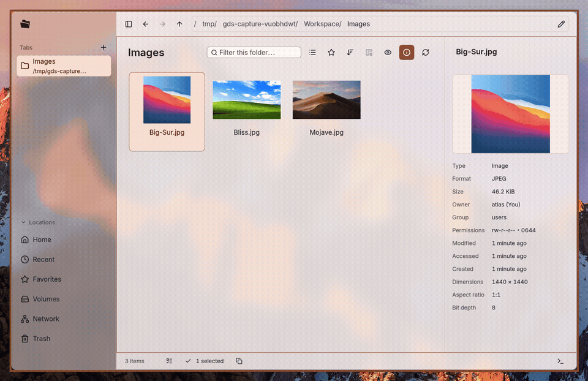

### Keyboard all the way!

Maybe you really don't have a mouse. We understand your predicament!

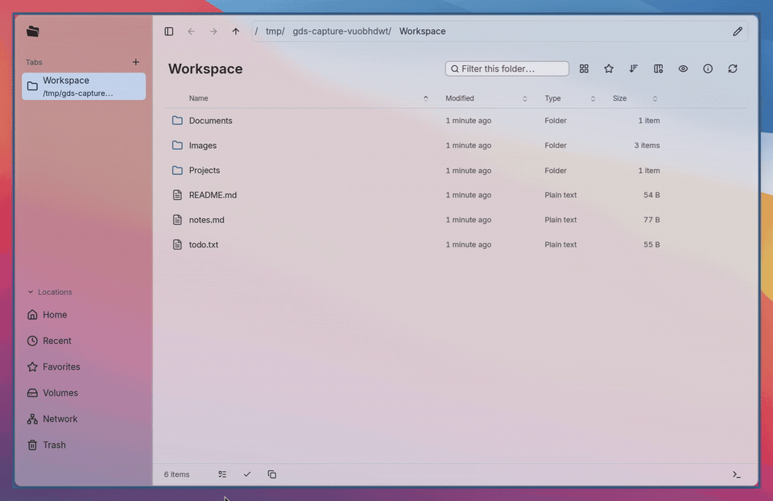

### And the absolute killer feature: **COPY PATH!!!**

Seriously, why do so many file managers still not support copying file paths? How is this even a thing?

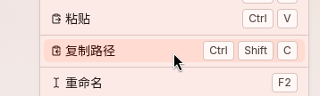

[Watch a file path being copied and pasted into the address bar](docs/assets/copy-path.gif).

## Install and launch

### Let your agent install it for you

```text
Install this file manager for me: https://github.com/GanDesktop/gds/blob/main/bin/files/README.md
```

### Nix installation (recommended)

**Install into your profile:**

```sh
nix profile add github:GanDesktop/gds#gds-files
```

**Install on NixOS:** Add this input to `flake.nix` and include `gds` in your `outputs` arguments:

```nix
inputs.gds.url = "github:GanDesktop/gds";
```

Add the following to your system's `modules` list:

```nix
gds.nixosModules.gds-files
gds.nixosModules.gds-portal
{
  programs.gds-files = {
    enable = true;             # Install Files and make it the default folder handler
    fileManager1.enable = true; # Handle requests such as "Show in Folder" from other apps
  };
  services.gds-portal.enable = true; # Install GDS Portal separately for system file dialogs
}
```

Rebuild from your system configuration directory:

```sh
sudo nixos-rebuild switch --flake .
```

### Native packages

Packages are available for x86_64 Arch Linux, Debian 13, and Fedora 43. Run:

```sh
curl -fsSL https://gds.gandesktop.dev/install.sh | bash
```

You can also download a package from [GitHub Releases](https://github.com/GanDesktop/gds/releases) and install it with your system's package manager. Install a newer package to upgrade. For system file dialogs, pass `--with-portal` to the script (`bash -s -- --with-portal`) and follow the [Portal configuration guide](../../docs/apps/files/fedora.md#optional-gds-portal).

After installation, open **GDS Files** from the application menu or run `gds-files`.

## Customize the appearance

### Themes

Follow your system theme, choose a built-in theme, or use a custom theme.

| Desktop environment | System appearance followed |
| --- | --- |
| DankMaterialShell | System colors and light/dark mode, including colors generated from the wallpaper |
| KDE Plasma | System color scheme |
| GNOME | System light/dark preference and GTK appearance |

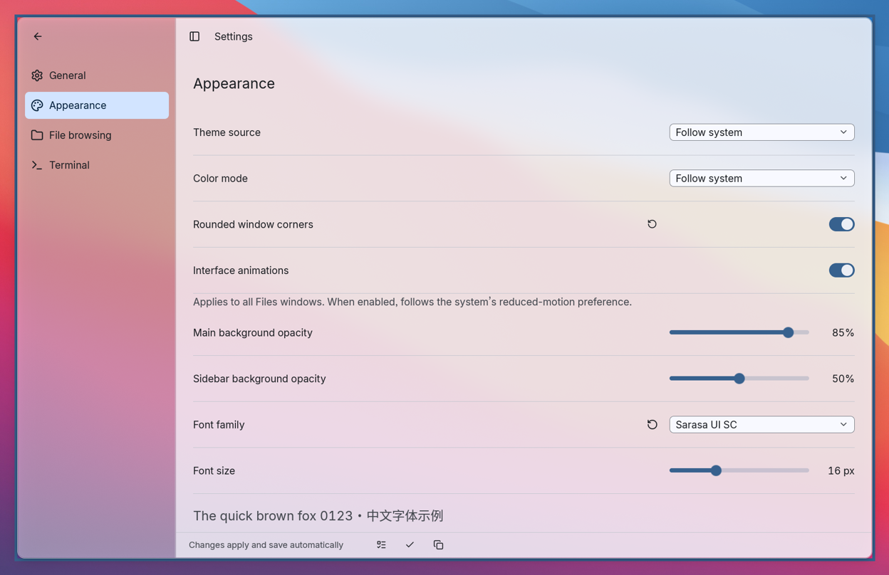

### Transparency

Adjust the main area and sidebar opacity separately. Here is the same window against the same wallpaper:

| Opaque | Translucent |
| --- | --- |
| 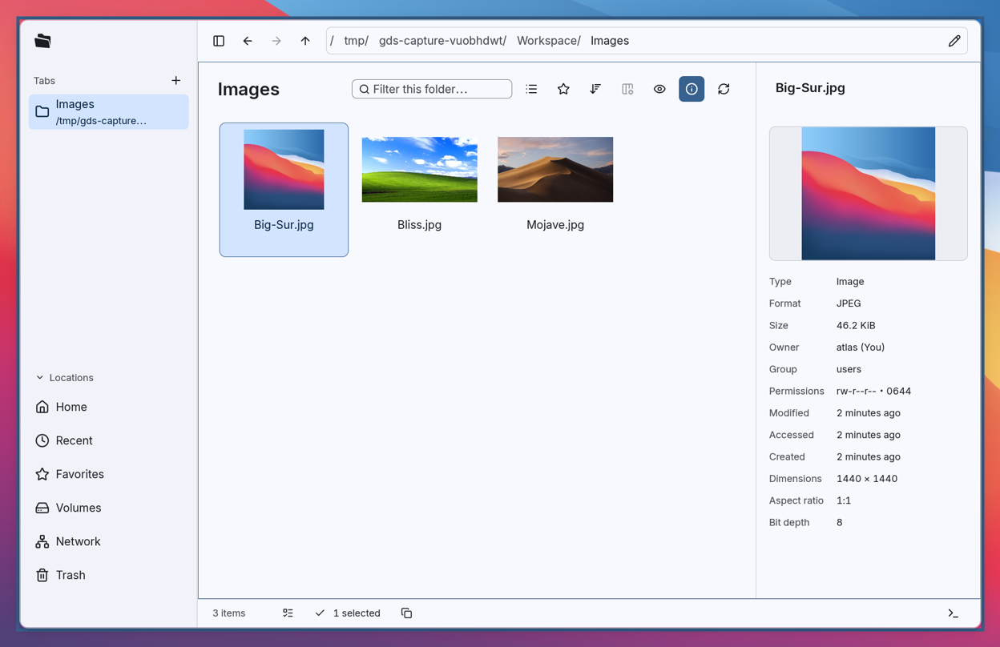 | 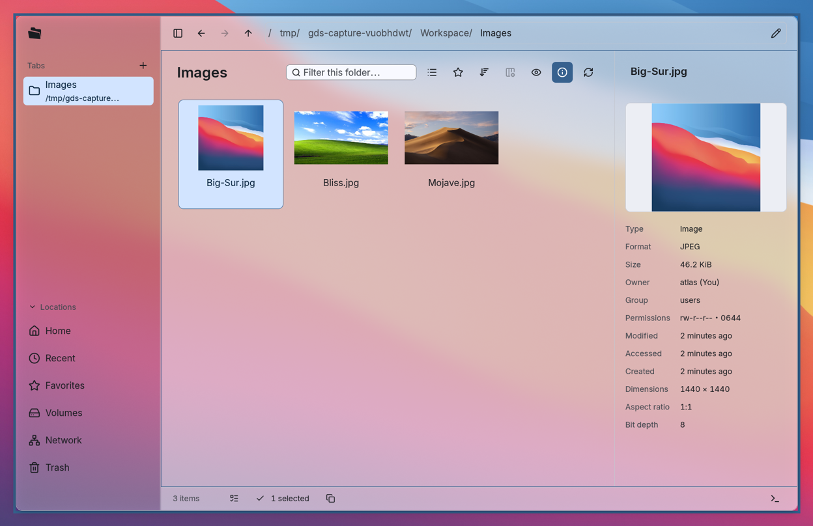 |

### Rounded corners

| Rounded corners off | Rounded corners on |
| --- | --- |
| 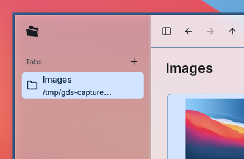 |  |

### Font and text size

Choose your preferred font and text size. This comparison uses the host's font at 14 px and 20 px.

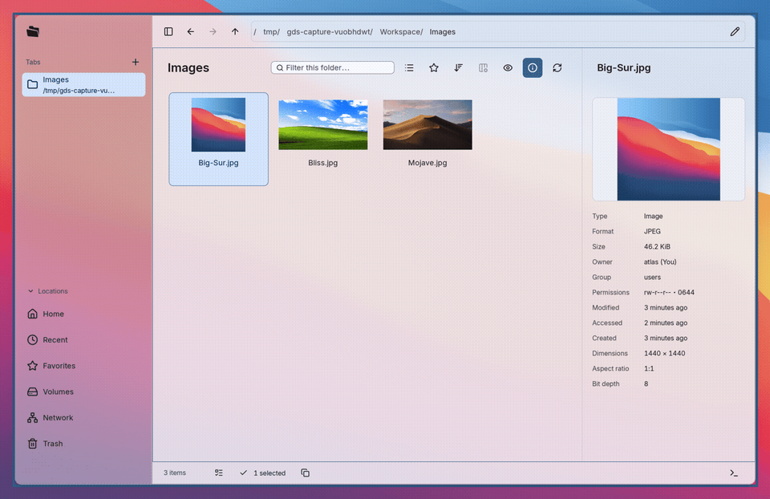

### Animations

The sidebar and details panel animate as they expand and collapse. You can turn animations off in the appearance settings.


## Settings and data

Open **Settings** from the main menu. Changes take effect immediately and are saved automatically.

On Linux, data lives in the following locations. If you set XDG environment variables, their directories are used instead:

| Data | Default location |
| --- | --- |
| Application settings | `~/.config/gds/app/files/settings.toml` |
| Favorites, recent locations, and view preferences for each location | `~/.local/state/gds/files/state.sqlite` |
| Standard thumbnail cache | `~/.cache/thumbnails/` |

## File picker

GDS Portal is GDS's desktop Portal backend. It currently provides the file chooser interface. Once GDS Portal is enabled, apps that use this interface can open Files' native picker, specifying open or save mode, file types, an initial location, and other options.

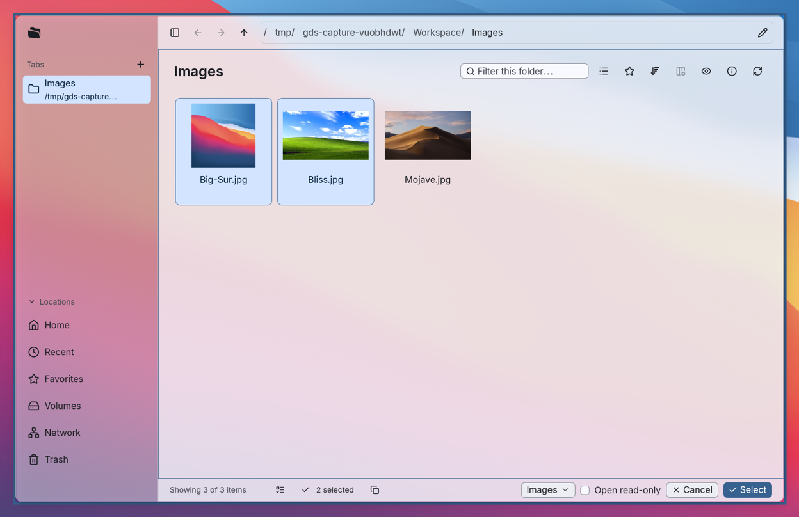

## Debug

Run the following command to enable in-memory logs and the log panel for this process. This feature is off by default:

```sh
gds-files --enable-logs
```

## License

GDS Files' own code is licensed under [Apache-2.0](../../LICENSE). Third-party dependencies keep their respective licenses.

## Development and integration

From the repository root, build the development version or launch it with logging enabled:

```sh
just build files
just dev files --enable-logs
```

See the [development guide](../../docs/development.md) for the development environment and build instructions.

You can also call the file picker from the command line when integrating it with another application:

```sh
gds-files --pick-file --multiple --filter 'Images:*.png,*.jpg,*.webp'
gds-files --pick-directory "$HOME/Documents"
```

On confirmation, the command-line picker writes JSON to standard output and exits. Canceling returns no selected files. See the [file picker documentation](../../docs/apps/files/picker.md) for arguments and the output format.

See the [capture guide](docs/assets/capture.md) to record the screenshots and GIFs again.
