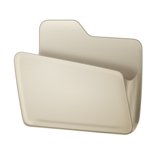
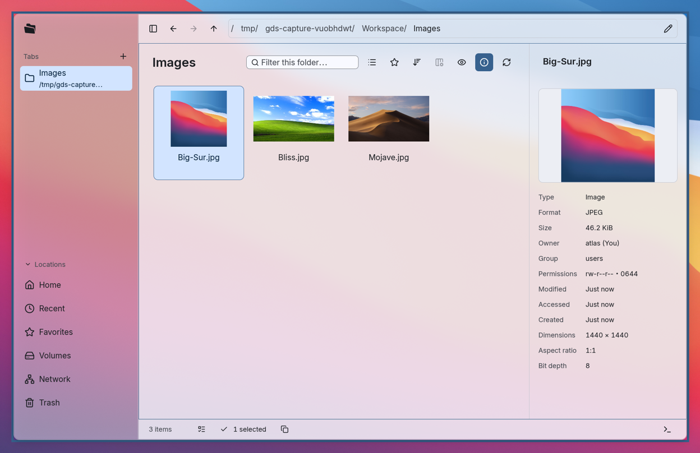
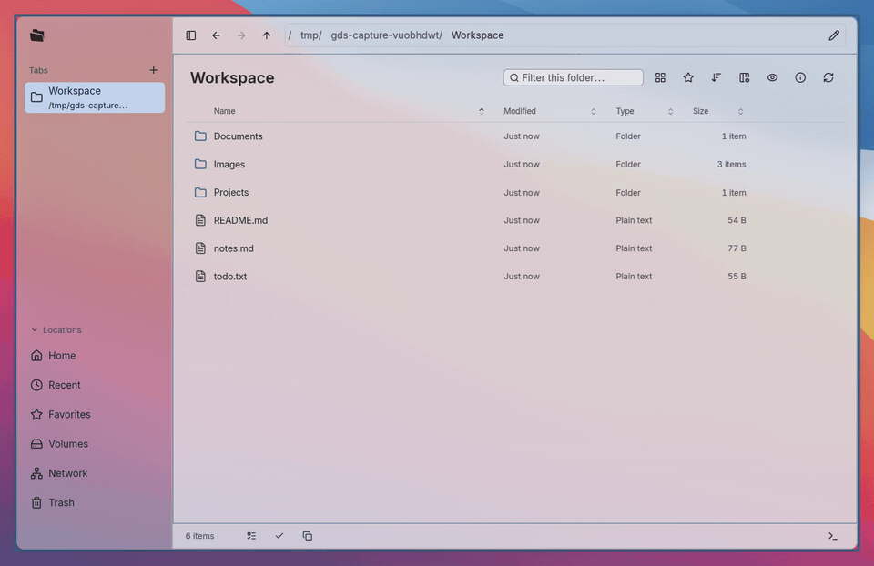
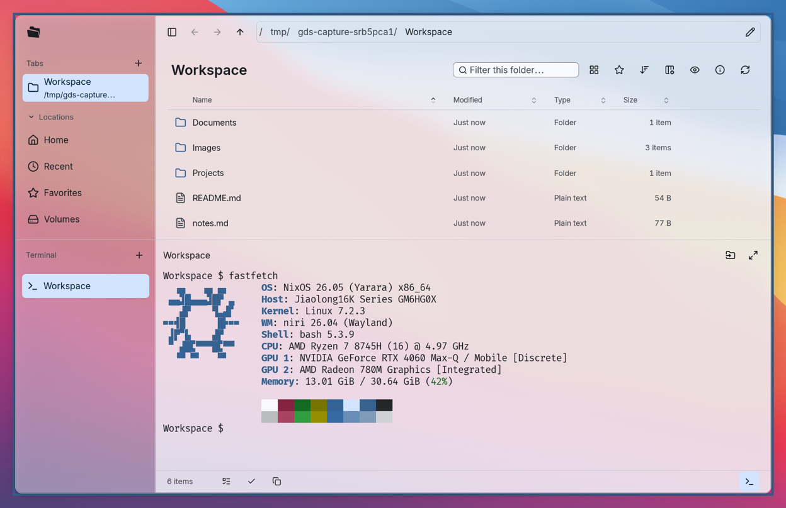
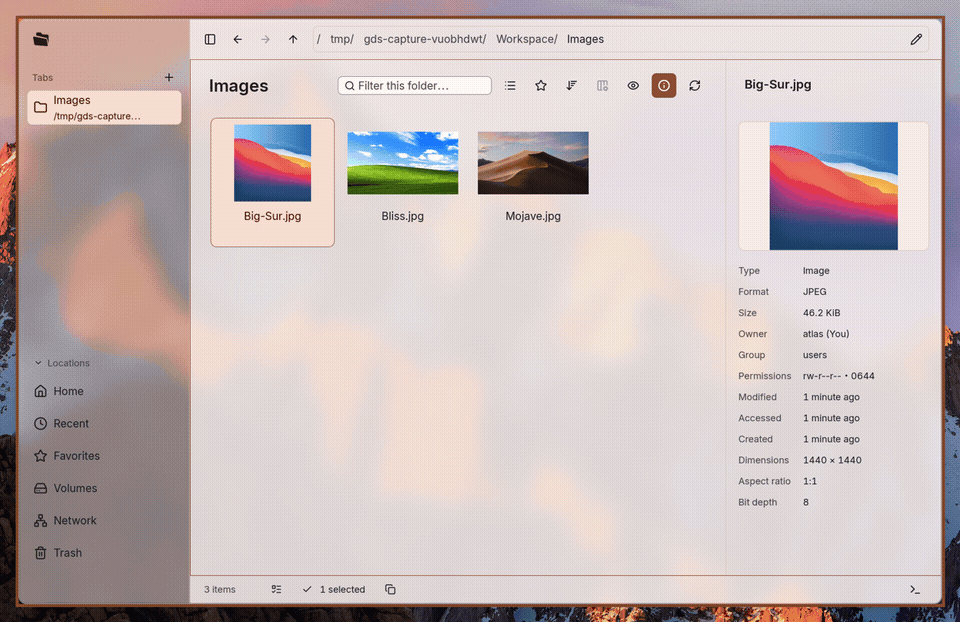
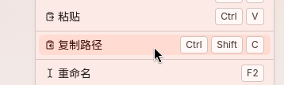

> 本项目仍处于早期开发阶段，功能与界面会持续调整。
> 首要支持 **Linux + Wayland**。X11、Windows 和 macOS 的适配仍在完善。

#  GDS Files

GDS Files 是基于GPUI开发的原生文件管理器。专注于为Wayland用户提供一个美观易用的文件管理体验。



## 关键功能
### 大猩猩也会用！
完整的文件浏览器功能，类似Windows文件浏览器的体验，非专业人士也能快速上手。



### 我去！内置终端！
的确，在linux的环境上，终端或许比文件浏览器更不可或缺，为了更方便专业用户的体验，我们内置了一个简单的终端。



### 半透明的窗口，跟随我的系统主题变动。
这下你终于可以看到你的二次元美少女壁纸了，我知道这很重要。除此之外，你还可以调节字号和字体，获得最适合你的体验。



### 全键盘操作！
也许你的确没有鼠标呢？我们非常理解您的处境！

### 还有最炸裂的功能：**复制路径！！！**
天哪，为什么这么多文件浏览器都不支持复制文件路径，简直让人感觉不可思议。


## 安装与启动
### 让您的agent帮您安装
```
帮我安装这个文件浏览器：https://github.com/GanDesktop/gds/blob/main/bin/files/README.md
```

### 一键安装

在终端运行（需要 `curl` 和 Bash）：

```sh
curl -fsSL https://gds.gandesktop.dev/install.sh | bash
```

脚本自动识别系统，下载最新正式 Release 中的 Files 安装包，校验 SHA-256 后调用包管理器安装；需要时会通过 `sudo` 请求管理员密码。支持 x86_64 的 Arch Linux、Debian 13 和 Fedora 43。NixOS 自动使用现有 Nix 安装 Files，默认跟踪 flake 的主分支；其它系统也可加 `--nix` 使用已安装的 Nix。

同时安装可选的文件选择器后端：

```sh
curl -fsSL https://gds.gandesktop.dev/install.sh | bash -s -- --with-portal
```

可追加 `--version v0.0.1` 指定发布版本（将 tag 换成实际版本，也支持预发布）。安装 Portal 后仍需配置桌面使用它，见下方说明。原生包升级时重新运行安装命令；Nix 安装的更新使用 `nix profile upgrade`。

### 通过包管理器
从 [GitHub Releases](https://github.com/GanDesktop/gds/releases) 下载对应系统的 `gds-files` 安装包。当前发布构建目标为 **x86_64 的 Arch Linux、Debian 13（trixie）和 Fedora 43**；新版本发布后，附件需要等待自动打包完成才会出现。

在下载目录运行对应命令（请只保留要安装的版本，避免通配符匹配多个旧包）：

| 系统 | 安装命令 |
| --- | --- |
| Arch Linux | `sudo pacman -U ./gds-files-git-*-x86_64.pkg.tar.zst` |
| Debian 13 | `sudo apt install ./gds-files_*_amd64.deb` |
| Fedora 43 | `sudo dnf install ./gds-files-*.fc43.x86_64.rpm` |

包管理器会从已配置的软件源安装依赖。安装完成后，从应用菜单打开 **GDS Files**，或运行 `gds-files`。这些是原生安装包，不需要本机编译；不保证可用于其它发行版或版本。

需要将 Files 用作系统文件选择器时，再下载同一 Release 的 `xdg-desktop-portal-gds` 包并安装：

```sh
# Arch Linux
sudo pacman -U ./xdg-desktop-portal-gds-git-*-x86_64.pkg.tar.zst
# Debian 13
sudo apt install ./xdg-desktop-portal-gds_*_amd64.deb
# Fedora 43
sudo dnf install ./xdg-desktop-portal-gds-*.fc43.x86_64.rpm
```

Portal 是可选组件，安装不会自动切换系统文件选择器；配置方法见 [Portal 配置说明](../../../../../docs/apps/files/fedora.md#optional-gds-portal)。

升级时下载新版本并重新执行安装命令。直接安装 Release 附件不会添加软件源，因此不会通过系统更新自动升级 GDS。Release 同时提供 `SHA256SUMS`，可用于核对下载文件的 SHA-256。

### Nix安装

**Profile 安装**：

```sh
nix profile add github:GanDesktop/gds#gds-files
```

**NixOS 系统安装**：在 `flake.nix` 添加输入，并将 `gds` 加入 `outputs` 参数：

```nix
inputs.gds.url = "github:GanDesktop/gds";
```

在系统的 `modules` 列表中加入：

```nix
gds.nixosModules.gds-files
gds.nixosModules.gds-portal
{
  programs.gds-files = {
    enable = true;              # 安装 Files，默认作为文件夹打开程序
    fileManager1.enable = true; # 支持其他应用的“在文件夹中显示”等请求
  };
  services.gds-portal.enable = true; # 单独安装 GDS Portal，提供系统文件选择接口
}
```

在系统配置目录重建：

```sh
sudo nixos-rebuild switch --flake .
```

## 定制样式
### 主题
您可以选择跟随系统的主题，使用我们内置的主题，或者自定义主题。
<!--此处列举支持的系统主题的表格-->

### 定制应用的细节
您可以在配置中自定义界面的
- 透明度
<!--此处展示统一位置不同透明度的对比-->
- 圆角
<!--此处展示统一位置开关圆角的对比-->
- 字体与字号
- 动画效果


## 设置与数据

从主菜单进入“设置”。设置更改立即生效并自动保存。

Linux 下的数据位置如下；设置了 XDG 环境变量时，使用对应的目录：

| 内容 | 默认位置 |
| --- | --- |
| 应用设置 | `~/.config/gds/files/settings.toml` |
| 收藏、最近位置与各位置的视图偏好 | `~/.local/state/gds/files/state.sqlite` |
| 标准缩略图缓存 | `~/.cache/thumbnails/` |


## 文件选择器

GDS Portal 是 GDS 的桌面 Portal 后端，目前提供文件选择接口。启用 GDS Portal 后，采用该接口的应用可以唤起 Files 的原生选择器，指定打开或保存模式、文件类型、初始位置和其他选择项。

## Debug

使用以下命令启用本进程的内存日志与日志面板；默认不开启此功能：

```sh
gds-files --enable-logs
```

## 许可证

GDS Files 的自有代码采用 [Apache-2.0 许可证](../../../../../LICENSE)，第三方依赖保留各自的许可证。

## 开发与集成

在仓库根目录构建开发版，或启用日志启动：

```sh
just build files
just dev files --enable-logs
```

开发环境与构建方法见[开发指南](../../../../../docs/development.md)。

集成文件选择器时，也可以通过命令行调用：

```sh
gds-files --pick-file --multiple --filter '图片:*.png,*.jpg,*.webp'
gds-files --pick-directory "$HOME/Documents"
```

命令行选择器确认后向标准输出写入 JSON，再退出；取消时不会返回选中文件。参数和返回格式见[文件选择器说明](../../../../../docs/apps/files/picker.md)。
