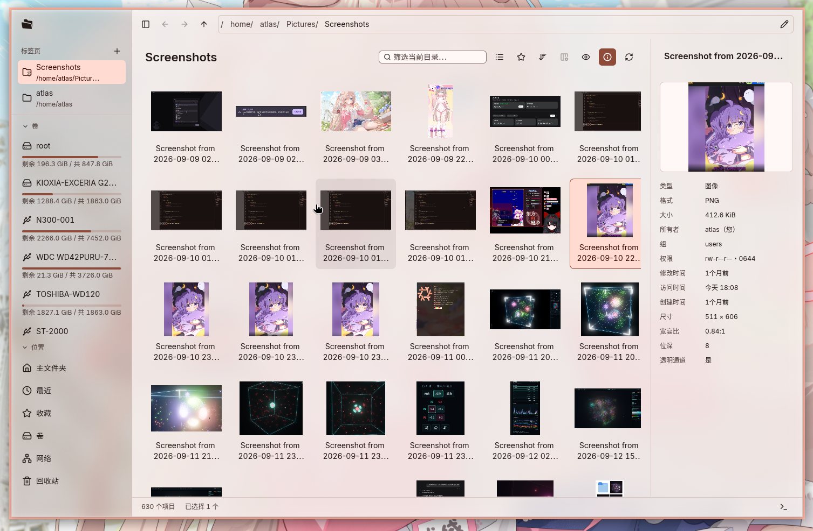

# GDS（Gan Desktop Suit）
GDS 是一个旨在为一般人提供一个现代，简单，易用，且美观的wayland桌面的计划。

我们将会围绕一套设计语言，打造一系列在Linux中您每天都会用到的软件，最终让没有专业背景的普通用户也能顺利的使用Linux。

我们关注软件的视觉体验，特别是个性化的与跟随系统的主题方案。

在项目的早期，我们会专注Niri + Nixos + DMS这个组合场景。补齐DMS中缺少或不完善的桌面软件。

## 桌面软件
### 文件

GDS Files，一个原生文件管理器，提供熟悉的文件浏览体验、内置终端和全键盘操作，方便日常浏览与整理文件。

[查看详细介绍与安装说明 →](../../../bin/files/docs/i18n/zh-CN/README.md)
