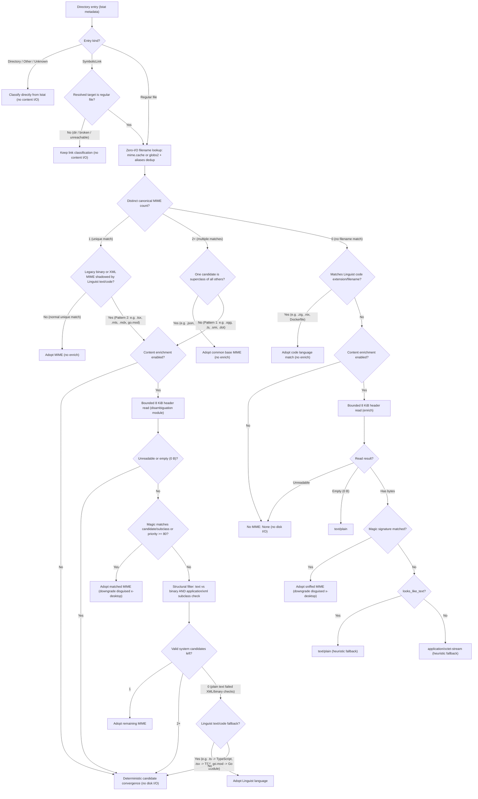
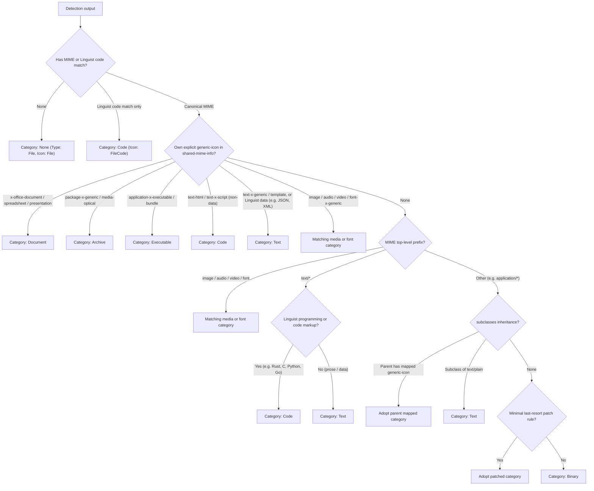
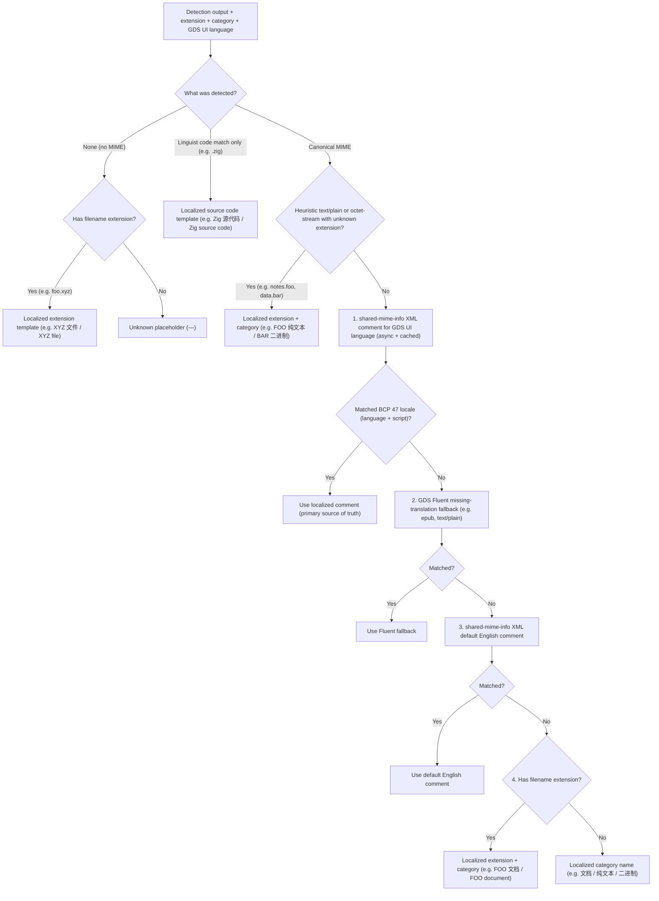

# File Type Detection and Display in GDS Files

Use Linux `shared-mime-info` as the primary source of truth for MIME detection, localized type descriptions, and generic icon hints, supplemented by a generated GitHub Linguist language table for source-code classification and modern developer extensions. GDS Files already uses `shared-mime-info` for detection. Reading its descriptions lets the Detailed Type column and Properties show recognizable format names in the app's language without maintaining a large manual mapping table. GDS owns the mapping from generic icon hints to its file categories and icons. [Shared MIME-info specification](https://specifications.freedesktop.org/shared-mime-info/latest-single/)

## Current behavior

- **Detection.** `xdg-mime` matches the full filename against installed plain-text rules, including compound extensions and literal names. GDS Files takes the first MIME candidate from an unordered `HashSet` and normalizes aliases. A local file with no usable filename match can be classified using a header probe bounded to 8 KiB, then a text or binary heuristic. [Detection code](../../bin/files/src/entities/file/api/directory/content.rs)
- **Display.** `mime-types.toml` contains 109 presentation rules listing 166 MIME strings, including aliases. It supplies categories and untranslated short names such as `Rust` and `PNG`. For known MIME types outside the table, the detailed label falls back to the final extension in uppercase or to the MIME string. An unlisted `application/*` type falls into the Binary category and receives a generic file icon. Properties also overrides the Format row for `FileFacts::Text` and media decoders instead of sharing the Detailed Type lookup. [Presentation table](../../bin/files/src/entities/file/api/directory/content/assets/mime-types.toml) · [Labels](../../bin/files/src/entities/file/ui/presentation.rs) · [Icons](../../bin/files/src/entities/file/ui/icon.rs) · [Properties view](../../bin/files/src/pages/workspace/inspection.rs)

## Data sources and language coverage

The installed `shared-mime-info` 2.4 package on the development machine contains 908 MIME types with default English descriptions. Of these, 735 (81%) have Simplified Chinese descriptions tagged `zh-Hans-CN`. These counts come from the generated per-type XML files for the package and vary with the installed database version. [Per-type XML format](https://specifications.freedesktop.org/shared-mime-info/latest-single/#id-1.3.6)

| Filename | Canonical MIME | Simplified Chinese description in 2.4 |
| --- | --- | --- |
| `scene.blend` | `application/x-blender` | Blender 场景 |
| `installer.dmg` | `application/x-apple-diskimage` | Apple 磁盘映像 |
| `template.ots` | `application/vnd.oasis.opendocument.spreadsheet-template` | ODS 模板 |

All three MIME types above are absent from the GDS presentation table. The ODS template also has the `x-office-spreadsheet` generic icon hint, which drives a GDS document icon and category. [Upstream MIME definitions](https://cgit.freedesktop.org/xdg/shared-mime-info/tree/data/freedesktop.org.xml.in)

**Source-code coverage.** `shared-mime-info` does not define a dedicated `Code` category: only ~30 scripting/data types carry `text-x-script` (including `application/json`), while common source types such as `text/rust`, `text/x-csrc`, `text/x-go`, and `text/x-python` have no generic icon hint, and modern developer extensions such as `.zig`, `.nix`, `.jsx`, and `Dockerfile` are absent in 2.4. Generating a compact read-only table from [GitHub Linguist `languages.yml`](https://github.com/github-linguist/linguist/blob/main/lib/linguist/languages.yml) (`programming` and code `markup` vs `data`) provides maintainable `Code` classification and zero-I/O fallback for missing developer extensions without hand-maintaining a large local table.

`mime-db` v1.54.0 lists 2,522 MIME types, 1,015 of which have at least one extension. Its published JSON has no localized type descriptions. It can supplement remaining observed filename coverage gaps if needed. The IANA registry is a reference for registered MIME names. [mime-db schema](https://github.com/jshttp/mime-db#data-structure) · [Versioned data](https://github.com/jshttp/mime-db/blob/v1.54.0/db.json) · [IANA Media Types](https://www.iana.org/assignments/media-types/)

## Decision flow

The pipeline separates authoritative filesystem object classification (`lstat`), MIME resolution (keeping the vast majority of files off disk I/O), category/icon derivation, and localized human-readable naming.

### 1. Entry and MIME detection

### 2. Category and icon classification

### 3. Human-readable name resolution

## Proposed rollout

1. **Localized descriptions.** Make `shared-mime-info` per-type XML `<comment>` entries the primary source of truth for display names, retiring the untranslated short-name overrides in `mime-types.toml`. Look up the canonical MIME in XDG data locations (`$XDG_DATA_HOME/mime`, then `$XDG_DATA_DIRS/*/mime`) off the UI thread and cache parsed `<comment>` entries in memory. Select the description strictly by the GDS interface language (ignoring system `LANG`/`LC_*`) using `unic-langid` (`likelysubtags`) generic BCP 47 `(language, script, region)` matching with CLDR likely-script inference—requiring matching language and compatible script (so e.g. `zh-CN` matches `zh-Hans-CN` and rejects `zh-Hant-TW`, and `sr-Latn` rejects `sr-Cyrl`, without per-language special cases) and ranking exact region, neutral region (or untagged neutral English for `en`), then other regions. Fall back to a small Fluent table for common missing translations (such as `application/epub+zip`, `text/plain`, and `application/octet-stream`), then the default English `<comment>`, then a localized category label (including the uppercase extension when available). Heuristic generic fallbacks (`text/plain` / `application/octet-stream`) and unprobed unknown files retain their uppercase extension in the label when present (e.g., `FOO 纯文本`, `XYZ 文件`). Unify the Detailed Type column, `DetailedType` sorting, and the Properties Format row on this lookup, and expose the raw canonical MIME on a dedicated row in Properties. [XDG locations used by `xdg-mime`](https://docs.rs/xdg-mime/0.4.0/xdg_mime/#loading-the-shared-mime-database) · [GDS language settings](../../src/i18n.rs)
2. **Category and icon coverage.** Derive `ContentCategory` primarily from `shared-mime-info` and generated GitHub Linguist data rather than a large manual table: check own explicit `generic-icons` first, then MIME top-level prefixes (before `subclasses`, preventing `text/x-python` from inheriting `application-x-executable`), refine `Text` results matching Linguist `programming` or code `markup` into `Code` (keeping `data` formats such as JSON/YAML/TOML/XML in `Text`), then check `subclasses` inheritance, and demote manual rules to a minimal last-resort patch before `Binary`. Apply the category consistently to the Type column, icons, and Type sorting, and keep non-text `Document` formats (such as `.ots`, `.pdf`, `.docx`) out of `Kind::Text` preview selection. [Generic icons](https://specifications.freedesktop.org/shared-mime-info/latest-single/#id-1.3.10) · [Type sorting](../../bin/files/src/entities/file/model/sorting.rs) · [Preview selection](../../bin/files/src/entities/file/api/directory/inspection.rs)
3. **Unified disambiguation and toggleable content enrichment.** Keep the vast majority of files on the zero-I/O fast path: unique non-shadowed MIME matches, parent-plus-subclass-only multi-matches (such as `.json`, `.opus`, `.oga`, and `.djvu`, collapsed directly to their common base MIME), genuine XML code formats (`.xhtml`, `.xslt`), and Linguist zero-I/O code-extension matches all skip disk reads. Consolidate conflict detection and bounded 8 KiB resolution into a dedicated [`disambiguation`](../../bin/files/src/entities/file/api/directory/content/disambiguation.rs) module covering two general patterns: (1) multi-MIME filename conflicts (~37 globs such as `.ogg`, `.ts`, `.smi`, `.otf`, `.dot`, `.m`) and (2) single legacy binary or XML `shared-mime-info` matches shadowed by a non-XML Linguist text/code format (such as `.tsx` vs Tiled XML, `.mts` vs `video/mp2t`, `.mdx` vs Sega 32X ROM, `go.mod` vs `audio/x-mod`, `.sml` vs SMIL XML). During 8 KiB probing, apply magic matching followed by structural validation (text vs binary and `application/xml` subclass header checks); if all system candidates fail structural validation on plain-text content, fall back to the matching Linguist language. Make background content enrichment a user-toggleable setting for lower-end machines: when disabled, conflicts converge deterministically without disk I/O and unmatched entries stay `None` (rendered via extension/unknown fallbacks). [Recommended checking order](https://specifications.freedesktop.org/shared-mime-info/latest-single/#id-1.3.15) · [Local entry enrichment](../../bin/files/src/entities/file/api/directory/enrich.rs)
4. **Binary `mime.cache` alignment.** Align the MIME index backend with mainstream Linux file managers (GNOME/GIO and KDE/Qt): prefer reading the precompiled binary `mime.cache` (via `mmap` with indexed literal, reverse-suffix, and glob lookups) and fall back to the plain-text index files (`globs2`, `aliases`, `subclasses`, `generic-icons`, `magic`) only when `mime.cache` is absent. Currently `xdg-mime` 0.4 parses only the plain-text indexes and scans all glob rules linearly in an unordered `HashSet` per filename lookup. Because `mime.cache` does not contain `<comment>` strings, localized descriptions still come from on-demand per-type XML reads.

## Acceptance checks

- With GDS set to Simplified Chinese, `.blend`, `.dmg`, and `.ots` show their localized descriptions in Detailed Type and Properties even when the system locale is English, and Properties also displays the raw canonical MIME.
- A MIME with no Simplified Chinese comment, such as `application/epub+zip` in the sampled 2.4 package, skips Traditional Chinese (`zh-Hant-TW`) and follows the fallback order. A missing database description or heuristic fallback on an unknown extension (e.g., `notes.foo`, `data.bar`) produces a readable label retaining the extension.
- An `.ots` file uses the document category and icon without triggering plain-text preview. A `.tar.gz` file retains its compound-extension match and uses the archive category and icon. Source files such as `.rs`, `.py`, `.zig`, and `.nix` classify as Code with the code icon, while `.json` stays Text.
- Unique non-shadowed filename matches, genuine XML code formats (`.xhtml`, `.xslt`), and parent+subclass-only globs (such as `.json`, `.opus`) avoid opening files for detection. Audio and video `.ogg` fixtures, TypeScript vs Qt Linguist vs MPEG-2 `.ts` fixtures, and shadowed formats (`.tsx`, `.mts`, `.mdx`, `go.mod`) are distinguished structurally when enrichment is enabled; disabling content enrichment skips header I/O while keeping deterministic, readable labels.
